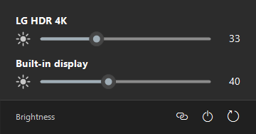
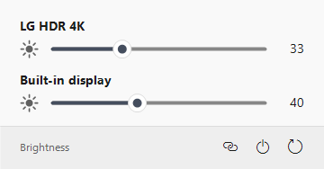
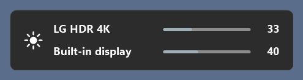
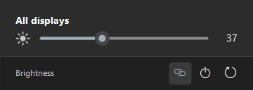

<h1 align="center">Twinkle Brightness</h1>

<p align="center">
  A <a href="https://windhawk.net">Windhawk</a> mod that adds brightness control for <b>every display</b> to the Windows system tray, with hotkeys, an on-screen indicator, schedules and idle dimming.
</p>

<p align="center">
  
  &nbsp;
  
</p>

Windows can change the backlight of most external monitors, but it doesn't
offer a slider for them and it can't adjust several displays at once.
Twinkle Brightness fills that gap. It was inspired by
[Twinkle Tray](https://github.com/xanderfrangos/twinkle-tray) and brings the
same idea to Windhawk as a single, small C++ mod. It needs no Electron runtime
and doesn't inject code into Explorer.

## Features

| | |
|---|---|
| **Tray panel** | Click the sun icon to get a slider for each display. Drag, scroll or use the arrow keys. |
| **Link displays** | The chain button links the displays: one slider sets all of them to the same level, and the hotkeys and the mouse wheel change all of them. Unlinked, the hotkeys change the display with the active window and the wheel changes the display under the cursor. |
| **Hotkeys** | Bind any key combination to increase, decrease or set brightness, turn the displays off, or open the panel. A hotkey can also target a specific display. |
| **On-screen indicator** | Shows the new level when you use a hotkey or the mouse wheel, with one row per display when they are at different levels. |
| **Mouse wheel** | Scroll over the tray icon, or anywhere on the taskbar, to change brightness. You can require a modifier key. |
| **Schedule** | Change brightness at set times of day with a smooth transition. |
| **Idle dimming** | Dim the displays after a period of inactivity and restore them on the next input. Can skip full-screen apps. |
| **Normalization** | Per-display minimum and maximum, so different monitors look equally bright at the same slider position. |
| **Theme aware** | Follows the Windows light/dark mode and accent color, with rounded corners on Windows 11. |

<p align="center">
  
  &nbsp;
  
  <br>
  
</p>

## Requirements

- Windows 10 or Windows 11
- [Windhawk](https://windhawk.net) 1.5 or newer
- **External monitors:** DDC/CI enabled in the monitor's on-screen menu
- **Laptop/tablet screens:** brightness control through WMI, the same method the
  Windows brightness slider uses

## Installation

### From Windhawk (recommended)

1. Open Windhawk and go to **Explore**.
2. Search for **Twinkle Brightness**.
3. Click **Install**.

> This works once the mod has been accepted into the
> [official Windhawk mods repository](https://github.com/ramensoftware/windhawk-mods).
> Until then, use the manual installation below.

### Manual installation

1. Open Windhawk and click **Create a new mod** on the home page.
2. Replace all of the editor's contents with
   [`twinkle-brightness.wh.cpp`](twinkle-brightness.wh.cpp).
3. Click **Compile Mod** in the sidebar, then **Exit Editing Mode**.
4. The sun icon appears in the notification area. You may need to drag it out of
   the overflow (`^`) area.

## Usage

- **Left-click** the tray icon to open the panel. Click outside it or press `Esc`
  to close it.
- **Right-click** the tray icon for these options:
  - **Refresh displays**: detect displays again, for example after reconnecting
    a cable.
  - **Turn off displays**
  - **Pause automatic brightness**: temporarily stops the schedule and idle
    dimming.
  - **Copy display info**: copies the name, ID and control method of each
    display, which you can use in the settings.
- Click the **chain** button in the panel to link or unlink the displays. It's
  on (highlighted) by default, and the mod remembers your choice.

  

  | | Panel | Hotkeys | Mouse wheel |
  |---|---|---|---|
  | **Linked** | One slider, all displays at the same level | All displays | All displays |
  | **Unlinked** | One slider per display | The display with the active window | The display under the cursor |

  A hotkey whose *Display* setting is filled in always changes that display.
- In the panel, you can drag a slider, scroll over it, or use `↑`/`↓` to choose
  a display and `←`/`→`, `PgUp`/`PgDn`, `Home`/`End` to change its level.

## Settings

Open the mod in Windhawk and go to the **Settings** tab.

| Setting | Description |
|---|---|
| Panel theme | Follow Windows, or always dark/light. |
| Show the on-screen indicator | Shown for hotkeys and the mouse wheel. |
| Hotkeys | A list of key combinations with an action, an amount and an optional display. Default: `Ctrl+Alt+Up` / `Ctrl+Alt+Down` change the brightness by 10% (all displays while linked). |
| Mouse wheel | Where scrolling changes brightness (off, tray icon, whole taskbar), the required modifier key and the step size. |
| Brightness schedule | A list of times (`HH:MM`, 24-hour) with a brightness level and an optional display. |
| Schedule options | Transition length, and whether to apply the latest entry on startup and after sleep. |
| Idle dimming | Idle time, dimmed level, and whether to skip dimming while a full-screen app runs. |
| Per-display options | Match a display by part of its name or ID, then set a custom name, min/max brightness or hide it. |

### Hotkey format

Combine `Ctrl`, `Alt`, `Shift` and `Win` with one key, separated by `+`:

```text
Ctrl+Alt+Up
Win+Shift+PageDown
Ctrl+Alt+F1
```

Supported keys: `A`-`Z`, `0`-`9`, `F1`-`F24`, `Up`, `Down`, `Left`, `Right`,
`PageUp`, `PageDown`, `Home`, `End`, `Insert`, `Delete`, `Space`, `Plus`,
`Minus`, `NumpadPlus`, `NumpadMinus`, `Numpad0`-`Numpad9`.

### Example: brighter days, dimmer evenings

| Time | Brightness | Display |
|---|---|---|
| `07:30` | `80` | *(empty: all displays)* |
| `19:00` | `50` | |
| `22:30` | `20` | |

## How it works

- **External monitors** use **DDC/CI** (MCCS VCP code `0x10`) through the
  Windows `dxva2` monitor configuration API. This is the same channel the
  monitor's own on-screen menu uses.
- **Built-in panels** use the `WmiMonitorBrightness` and
  `WmiMonitorBrightnessMethods` WMI classes.
- DDC/CI commands are slow, so the hardware is accessed on a background thread.
  Slider movements are coalesced per display, so dragging a slider never queues
  up a backlog of commands.
- The mod runs as a Windhawk
  [tool mod](https://github.com/ramensoftware/windhawk/wiki/Mods-as-tools:-Running-mods-in-a-dedicated-process)
  in its own `windhawk.exe` process. The mouse wheel feature uses a low-level
  mouse hook, so it doesn't inject anything into Explorer.

## Troubleshooting

<details>
<summary><b>A monitor says "Brightness control is not available"</b></summary>

- Turn on **DDC/CI** in the monitor's on-screen menu. It's often under
  *System*, *Setup* or *Other*.
- Use a direct HDMI, DisplayPort or USB-C cable. Docks, adapters, KVM switches,
  VGA and DVI often don't pass DDC/CI through.
- Then choose **Refresh displays** from the tray menu.

</details>

<details>
<summary><b>A monitor stops responding after sleep</b></summary>

Choose **Refresh displays** from the tray menu, or turn the monitor off and on
with its power button. The mod also re-detects displays automatically after
sleep and display changes.

</details>

<details>
<summary><b>A hotkey does nothing</b></summary>

Another program probably uses the same combination. Open the mod's log in
Windhawk and look for `RegisterHotKey failed`, then pick a different
combination.

The default `Ctrl+Alt+Up` / `Ctrl+Alt+Down` are also used by some other
software, for example to add cursors in Visual Studio Code, or to rotate the
screen with older Intel graphics drivers. While the mod runs, its hotkeys take
precedence. If you need those shortcuts, change or remove the mod's hotkeys in
the settings.

</details>

<details>
<summary><b>Brightness changes have no visible effect (AMD)</b></summary>

The AMD Radeon software can override DDC/CI brightness. Disable
**Custom Colors** in the display settings of AMD Software.

</details>

## Development

The mod is a single file: [`twinkle-brightness.wh.cpp`](twinkle-brightness.wh.cpp).
To check that it compiles exactly the way Windhawk compiles it, and to try it
outside of Windhawk, run:

```powershell
.\tools\test-harness\build.ps1 -Run
```

The harness uses the compiler bundled with Windhawk. It detects your displays,
opens the panel, renders the on-screen indicator into `tools\test-harness\out`
and exits. It never changes your brightness.

See [CONTRIBUTING.md](CONTRIBUTING.md) for details.

## Credits

- [Twinkle Tray](https://github.com/xanderfrangos/twinkle-tray) by Xander
  Frangos, for the idea and for showing how pleasant multi-monitor brightness
  control can be.
- [Windhawk](https://windhawk.net) by Michael Maltsev (m417z).

This project isn't affiliated with Twinkle Tray or its author.

## License

[MIT](LICENSE)
